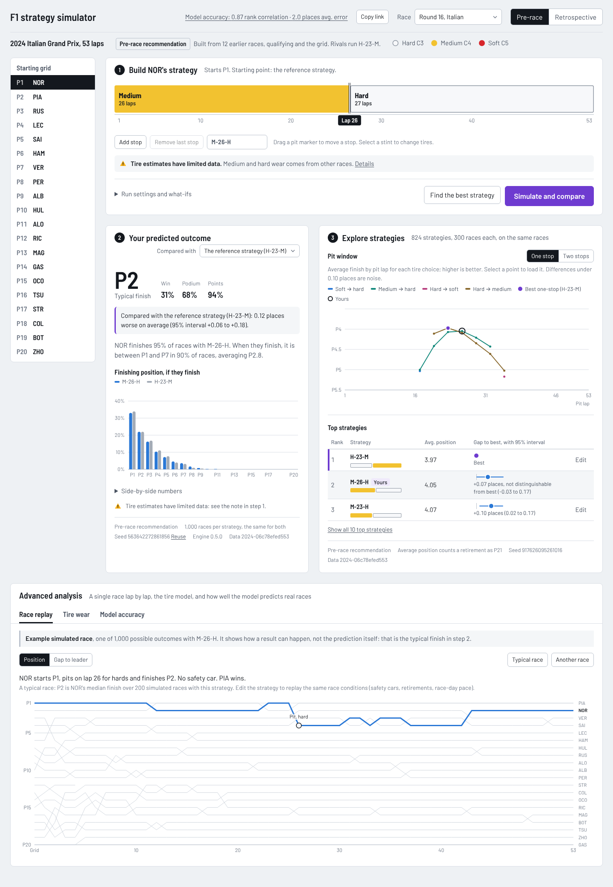
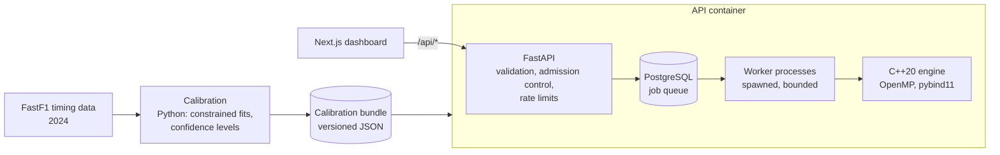

# F1 Race Strategy Simulator

**A full-stack Formula 1 strategy simulator built on a parallel C++20 Monte Carlo engine.**

Pick a driver at any of 20 dry 2024 Grands Prix, drag their pit stops around,
and see how the race plays out over thousands of simulated races, or let it
search every one- and two-stop strategy for the best one. The engine simulates
all 20 cars lap by lap, with tire wear, fuel, traffic, overtakes, pit stops,
safety cars and retirements, calibrated on real 2024 timing data.

**Tech stack:** C++20 · OpenMP · Python · pybind11 · FastAPI · PostgreSQL · Next.js · TypeScript · Docker



## Key results

| Metric | Result |
| --- | --- |
| Race prediction | 2.00 places average error vs. 2.33 for the starting grid; better in 12 of 15 races (leave-one-out)* |
| Monte Carlo throughput | 138,000 simulated races/s (Apple M3 MacBook Air, 8 threads) |
| Parallel scaling | 5.17× on 8 threads for Monte Carlo; 4.79× for strategy search |
| Strategy search | 824 strategies × 300 races each in 1.96 s |

<sub>*Predictions keep each driver's real race strategy, so they measure how
well the model predicts a race given the strategies, not whether its
recommended strategies are optimal. Benchmarks use a fixed workload on the 2024
Monza config. Details: [validation](docs/validation.md),
[performance](docs/performance.md).</sub>

## Features

- **Build strategies:** drag pit stops and change compounds on a lap-scaled
  timeline, or type a code like `M-24-H`.
- **Simulate outcomes:** typical finish and win, podium and points odds across
  thousands of simulated races.
- **Compare alternatives:** run two strategies on identical simulated races
  and get the difference with a 95% interval.
- **Optimize pit stops:** search every valid one- and two-stop strategy and
  chart the pit window.
- **Explore the race:** lap-by-lap replays, tire-wear curves, safety-car
  what-ifs, and the model's own accuracy.

## Quick start

Requires Docker.

```bash
git clone https://github.com/suchir-p/f1-strategy-simulator.git
cd f1-strategy-simulator
docker compose up --build
```

Open <http://localhost:3000>. This starts PostgreSQL, the API with the C++
engine, the Next.js dashboard and nginx. Before exposing it to anyone else,
see [docs/deployment.md](docs/deployment.md).

## Architecture



* **Engine (C++20):** lap-by-lap simulation of the full field, Monte Carlo
  over independent races with OpenMP, and exhaustive strategy search.
* **Calibration (Python):** fits driver pace, tire wear and fuel effect to
  real laps under physical constraints, and builds strictly pre-race configs.
* **API (FastAPI + PostgreSQL):** a PostgreSQL job queue feeding a bounded
  pool of worker processes that run the engine through pybind11.
* **Dashboard (Next.js + TypeScript):** the strategy builder, comparisons,
  charts and race replay.

## Engineering highlights

**Deterministic parallel simulation.** Every random draw is a hash of (seed,
race, lap, driver, event), so results are identical at any thread count and on
both Linux/GCC and macOS/Clang, and strategies are compared on exactly the
same luck, which makes comparisons far less noisy.

**Profiling-driven optimization.** Callgrind showed about 64% of the time
going into random numbers. Caching partial hashes and switching to insertion
sort for the nearly sorted running order cut instructions by 36% and made the
engine 1.42–1.45× faster on one thread, with bit-identical results checked by
checksums.

**Reliable job processing.** Jobs are claimed with `FOR UPDATE SKIP LOCKED`,
admission control runs under an advisory lock (429 when full), and engine
errors, worker crashes and restarts all end in explicit failure states.
Migrations run at startup, and a production mode adds per-client rate limits
behind nginx.

**Calibration that knows its limits.** Tire fits are constrained so wear
never makes a tire faster, every tire estimate is labeled by how much real
data backs it, and the optimizer is kept from exploiting stints longer than
any in the data.

**Tested end to end.** GoogleTest for the engine, 31 integration tests against
real PostgreSQL and worker processes, a test that pre-race configs can't see
the race result, Vitest and Playwright for the dashboard, and CI that starts
the whole stack from a clean checkout.

## Validation and limitations

Evaluated on 2024 race results using both chronological holdout and leave-one-out validation:

* **Prediction:** 2.00 vs. 2.33 places average error against the starting
  grid over 15 leave-one-out races; on the last 5 races of the season, held
  out entirely, 2.02 vs. 3.03 (those grids were unusually misleading).
* **Uncertainty:** 94% of real finishes fell inside the predicted 90% range
  on the held-out races.
* **Reproducing races:** fitted on the race itself, median rank correlation
  0.97 vs. 0.85 for the grid across 20 races.

Limitations:

* Predictions use the strategies drivers actually ran; rivals don't react to
  your strategy.
* Pre-race strategy advice depends on track-specific tire wear, which is
  uncertain before the race; recommendations can be robust and still wrong.
* Overtaking difficulty is the same at every track (the main miss is Saudi
  Arabia), and wet races and Monaco are excluded.
* Small samples: 20 races, 5 of them held out.

Future work: per-circuit overtaking difficulty, rivals that choose their own
strategies for fully pre-race prediction, and a shared rate-limit store for
running several API replicas.

Full methodology: [docs/validation.md](docs/validation.md) and
[docs/model.md](docs/model.md).

## Documentation

* [Simulation model and assumptions](docs/model.md)
* [Validation and calibration](docs/validation.md)
* [Performance and profiling](docs/performance.md)
* [Backend design and API reference](docs/backend.md)
* [Dashboard](docs/dashboard.md)
* [Deployment](docs/deployment.md)
* [Development: building from source, CLI, tests](docs/development.md)

## Development

```bash
cmake -S engine -B engine/build && cmake --build engine/build -j   # build the engine
ctest --test-dir engine/build --output-on-failure                  # engine tests
```

On macOS, install libomp first (`brew install libomp`) and add
`-DOpenMP_ROOT=$(brew --prefix libomp)` to the first command. The Python
module, CLI, running the services without Docker and the other test suites
are in [docs/development.md](docs/development.md).
